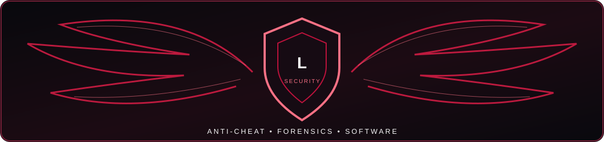

# LATASHI

### Anti-Cheat Engineering · Security Research · Full-Stack Development

 

**SECURITY RESEARCH** &nbsp; • &nbsp; **DIGITAL FORENSICS** &nbsp; • &nbsp; **SOFTWARE ENGINEERING** &nbsp; • &nbsp; **IT & NETWORKING**

---

## About Me

I'm **Latashi**, a security-focused **full-stack developer** with a primary interest in **anti-cheat engineering, Windows internals, digital forensics, and reverse engineering**. I also work across application development, automation, systems administration, and networking.

- 🛡️ **Anti-cheat:** integrity validation, detection logic, process inspection, runtime behavior, and evidence correlation
- 🔬 **Forensics:** Windows execution artifacts, memory analysis, event logs, and timeline reconstruction
- 💻 **Software:** front-end and back-end applications, APIs, databases, and developer tooling
- 🌐 **IT:** Windows/Linux systems, troubleshooting, infrastructure, and network fundamentals
- 📍 **Based in Türkiye** · **IT @ Cisco** *(personal profile; not an official company account)*

> **Engineering principle:** An indicator is a starting point, not proof. Reliable findings require context, validation, and reproducibility.

## Anti-Cheat & Security Engineering

<table>
<tr>
<td width="50%" valign="top">

### 🛡️ Detection & Integrity
- Client integrity and trust boundaries
- Process, thread, module, and handle analysis
- User-mode and kernel-mode visibility
- PE / DLL inspection and loading behavior
- Memory anomalies and injection indicators
- Signature, heuristic, and behavioral detections
- False-positive reduction and validation

</td>
<td width="50%" valign="top">

### 🔎 Digital Forensics & Runtime
- Prefetch, Amcache, Shimcache, BAM / DAM
- NTFS MFT and USN Journal analysis
- Windows Event Logs and Sysmon telemetry
- Registry, services, drivers, and persistence
- Memory inspection and timeline correlation
- Java agents, class loading, and JAR integrity
- Evidence provenance and incident documentation

</td>
</tr>
</table>

**Research toolkit:** `System Informer` · `Process Explorer` · `Autoruns` · `WinDbg` · `JADX` · `PE-bear` · `Detect It Easy` · `Wireshark` · `Sysmon` · `Event Viewer`

## Languages & Technologies

### Programming Languages

### Frontend & Backend

### Databases, DevOps & Systems

<b>Full technology index — expand</b>

| Domain | Languages, frameworks & technologies |
| --- | --- |
| **Programming** | Python, JavaScript, TypeScript, Java, C, C++, C#, Go, Rust, PHP, Ruby, Kotlin, Swift, Dart, Solidity |
| **Frontend** | HTML5, CSS3, React, Next.js, Vue, Angular, responsive UI |
| **Backend & APIs** | Node.js, Express, NestJS, Django, Flask, FastAPI, Laravel, Spring, .NET, REST APIs |
| **Databases** | PostgreSQL, MySQL, MongoDB, Redis, SQL |
| **DevOps & Systems** | Git, GitHub Actions, Docker, Kubernetes, Nginx, Linux, Windows, Bash, PowerShell |
| **Security & Forensics** | Windows internals, PE analysis, memory inspection, endpoint telemetry, forensic artifacts, Java runtime analysis |
| **Networking & IT** | TCP/IP, DNS, HTTP(S), routing, troubleshooting, infrastructure operations |

*This index covers the broader software ecosystem. Listed technologies do not imply equal proficiency, professional certification, or published work in every item.*

## Engineering Approach

| Principle | Practical application |
| --- | --- |
| **Evidence over assumptions** | Correlate artifacts instead of treating one detection as conclusive. |
| **Signal over noise** | Evaluate false positives, environmental differences, and benign explanations. |
| **Defense in depth** | Combine process, memory, filesystem, registry, and network observations. |
| **Reproducible research** | Document methods, test conditions, limitations, and validation steps. |
| **Responsible security** | Use authorized environments and respect privacy and disclosure boundaries. |

## Projects & Research

I use GitHub to document software development and security research. Public projects and write-ups will be featured here as they become available.

## GitHub Stats

Statistics reflect public GitHub data and depend on external services; they may occasionally fail to load.

---

### RESEARCH · VERIFY · ENGINEER · IMPROVE

Personal profile — views and projects are my own and do not represent my employer.

