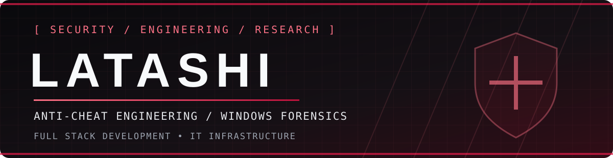
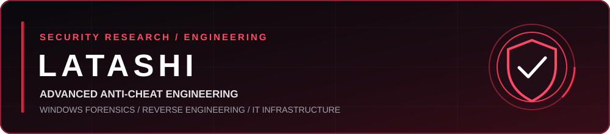

[LATASHI_README_UPDATED.md](https://github.com/user-attachments/files/33930073/LATASHI_README_UPDATED.md)
<div align="center">



<br />



<br />
<br />

<a href="https://github.com/latashi06"></a>


**ANTI-CHEAT ENGINEERING** `//` **DIGITAL FORENSICS** `//` **FULL-STACK DEVELOPMENT** `//` **IT INFRASTRUCTURE**

*Detection is an engineering problem. Evidence is the standard.*

</div>

---

### `01 / identity`

```text
alias         : LATASHI
primary       : Anti-Cheat Engineering & Detection Research
secondary     : Full-Stack Development / Windows Forensics / IT
professional  : IT @ Cisco
location      : Türkiye
approach      : Evidence-driven analysis, reproducible research, responsible disclosure
```

I focus on understanding **how software behaves, how integrity controls fail, and how to investigate those failures without confusing indicators with proof**. My interests span game security, Windows internals, runtime instrumentation, endpoint telemetry, detection logic, and the engineering behind reliable anti-cheat systems.

Outside security, I work across **application development, automation, networking, and IT infrastructure**.

### `02 / anti-cheat research`

<table>
<tr><td width="50%" valign="top">

**🛡️ Detection & Integrity**

- Client integrity and trust boundaries
- User-mode vs kernel-mode visibility
- Process and module inspection
- PE loading, injection indicators and memory anomalies
- Signature, heuristic and behavioral detection
- False-positive analysis and evidence correlation

</td><td width="50%" valign="top">

**🔬 Windows & Runtime Forensics**

- Prefetch, Amcache, Shimcache, BAM / DAM
- MFT, USN Journal and filesystem timelines
- Windows Event Log and Sysmon telemetry
- Service, driver and startup persistence review
- Java agents, class loading and JAR integrity
- Execution traces, provenance and timeline reconstruction

</td></tr>
</table>

> **Investigation principle:** A single detection, missing artifact or suspicious string is not sufficient evidence on its own. Findings should be reproducible, time-correlated and evaluated against legitimate explanations.

### `03 / technical toolkit`

<div align="center">

**Development**


**Systems & Infrastructure**


</div>

**Analysis tools** `System Informer` · `Process Explorer` · `Autoruns` · `WinDbg` · `JADX` · `PE-bear` · `Detect It Easy` · `Event Viewer` · `Sysmon` · `Wireshark`

**Areas** `Windows Internals` · `PE / DLL Analysis` · `Memory Inspection` · `Java Runtime` · `Network Analysis` · `Detection Engineering`

<sub>Technology icons represent areas of work and interest; repositories are the best place to evaluate actual implementations.</sub>

### `04 / engineering mindset`

| Principle | What it means in practice |
|:--|:--|
| **Signal over noise** | Separate high-confidence findings from weak indicators and scanner false positives. |
| **Traceability** | Correlate process, filesystem, registry and event-log evidence using timestamps and context. |
| **Defense in depth** | Consider multiple telemetry sources rather than depending on one detection technique. |
| **Reproducibility** | Document test conditions, expected behavior, limitations and validation steps. |
| **Privacy by design** | Minimize collection, use authorized environments and avoid unnecessary sensitive data. |

### `05 / development & infrastructure`

```text
FULL STACK    APIs • backend services • web interfaces • databases
AUTOMATION    Python • PowerShell • repeatable operational workflows
IT / NETWORK  Windows • Linux • troubleshooting • network fundamentals
SECURITY      endpoint investigation • telemetry • integrity analysis
```

### `06 / projects & research`

> **Research and project highlights will appear here as public repositories are released.**
>
> Topics: anti-cheat detection prototypes, forensic parsers, telemetry analysis, automation utilities and full-stack applications.

<!-- Replace this section with links to real projects as you publish them. -->

### `07 / GitHub activity`

<div align="center">


<sub>Statistics are generated by third-party services and may be temporarily unavailable.</sub>

</div>

---

<div align="center">

**`RESEARCH  >  VERIFY  >  ENGINEER  >  IMPROVE`**

<sub>Personal profile. Opinions and projects are my own and do not represent my employer.</sub>

</div>
